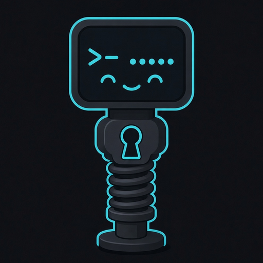

<p align="center"></p>
<h1 align="center">Pogo</h1>
<p align="center"><strong>Encrypt `.env` files and load them at startup.</strong></p>
<p align="center"><a href="https://github.com/JacksonJRay/pogo/releases/latest"></a> <a href="LICENSE"></a>  </p>
<p align="center"><a href="#install">Install</a> · <a href="#usage">Usage</a> · <a href="docs/reference.md">Docs</a> · <a href="docs/security.md">Security</a></p>

Plaintext `.env` files sit on disk, in repos, and where agents can read them. Pogo turns that file into `.env.enc` and loads it with `pogo run`.

<table><tr><td align="center"><strong>Encrypted at rest.</strong> Only `.env.enc` is meant to live on disk. No key file. The passphrase is never stored.</td><td align="center"><strong>One binary.</strong> Download and run. No runtime, SDK, or package install.</td><td align="center"><strong>Agent-safe.</strong> Agents can run your app. The passphrase prompt goes to you, not to them.</td></tr></table>

## Install

```bash
# https://github.com/JacksonJRay/pogo/releases/latest
grep pogo-linux-amd64 SHA256SUMS | sha256sum -c
chmod +x pogo-linux-amd64 && mv pogo-linux-amd64 /usr/local/bin/pogo
```

macOS: `shasum -a 256 -c`

## Usage

```bash
pogo convert .env
pogo edit
pogo run -- npm start
```

`convert` leaves `.env` and prints the `rm` command.

MIT. [LICENSE](LICENSE).
